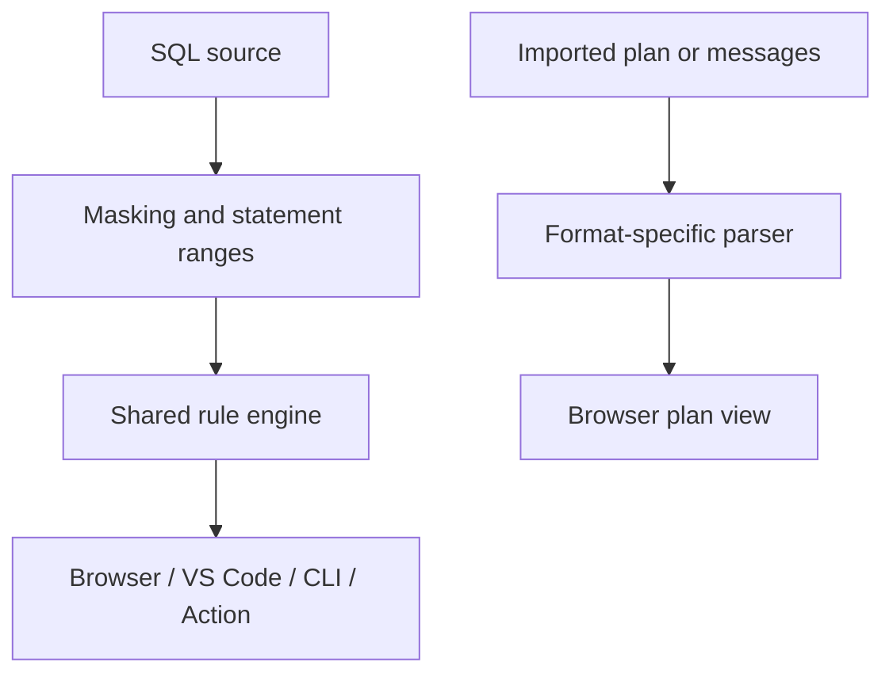

# Architecture

The browser app (`src/app`, `src/features`) and three integrations (`src/cli`, `src/action`, `src/vscode`) consume the shared analyzer in `src/core/analyzer`. Findings carry rule IDs, severity and source offsets. UI and reports translate stable keys through `src/i18n`; integrations must not duplicate a rule.

`src/core/explain` contains independent PostgreSQL JSON, SQL Server XML and SQL Server Messages readers. The parsers do not call a database or an external API. The Showplan XML parser uses a bounded SAX traversal; it retains per-worker counters and operator trees. `src/core/index-advisor` produces candidate indexes from SQL structure, without pretending to know existing indexes or workload cost.

The lexical/regex rule engine is fast and works offline but is not a complete SQL grammar. Complex nested/procedural constructs are a known boundary. Before broadening a rule, add a positive and a nearby negative fixture, preserve source ranges and check the target dialect. See [implementation status](docs/IMPLEMENTATION_STATUS.md).
