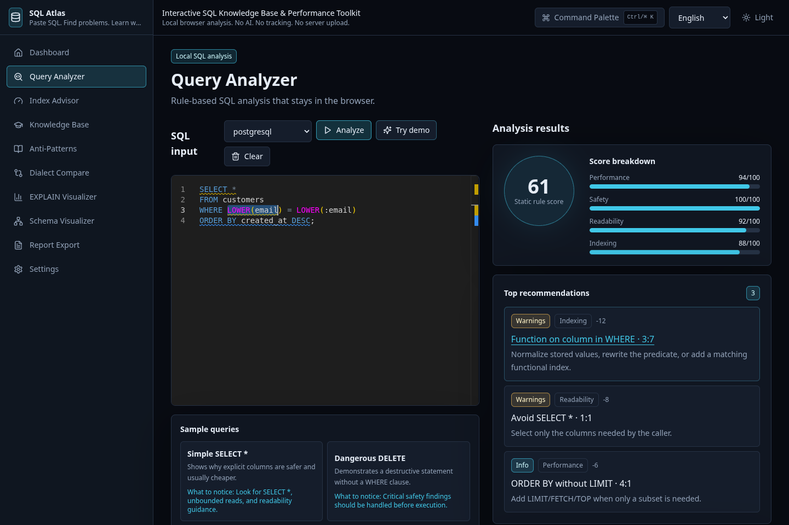
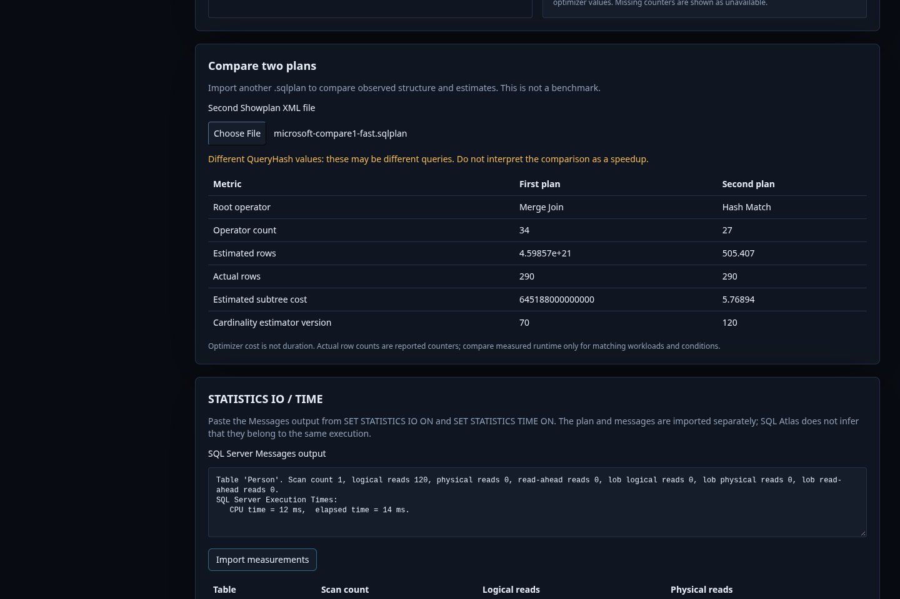
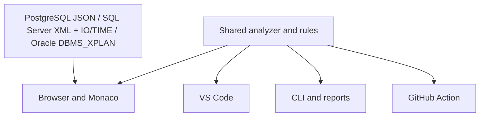

<p align="center"></p>

# SQL Atlas

**Find SQL issues where you write queries, then inspect the plan behind them.** SQL Atlas provides local diagnostics in VS Code, CI, the terminal and the browser, plus plan viewers for PostgreSQL, SQL Server and Oracle. No database connection or AI account is required.

[English](README.md) · [Polski](README.pl.md) · [Live app](https://milekv.github.io/sql-atlas/) · [npm](https://www.npmjs.com/package/sql-atlas) · [VS Code Marketplace](https://marketplace.visualstudio.com/items?itemName=Milosz.sql-atlas) · [GitHub Action](https://github.com/marketplace/actions/sql-atlas)

[](https://github.com/milekv/sql-atlas/actions/workflows/ci.yml) [](https://www.npmjs.com/package/sql-atlas) [](LICENSE)

> **Release boundary:** The browser demo follows `main`. The published npm CLI and GitHub Action tag are 0.8.0; the VS Code Marketplace extension is published separately and may lag behind this source. Check each listing before relying on a newer source feature. This is not a 1.0 release.

## Try it

```bash
npx --yes sql-atlas@0.8.0 analyze examples/safe-query.sql --dialect postgresql
```

Or open the [browser demo](https://milekv.github.io/sql-atlas/), choose a dialect and paste a query. Click a finding to move to its source line. Open **EXPLAIN visualizer** to import a plan; the viewer accepts PostgreSQL JSON, SQL Server Showplan XML or Oracle DBMS_XPLAN text. For local development, run `npm ci && npm run dev` and open the URL printed by Vite.

```sql
SELECT * FROM users WHERE LOWER(email) LIKE '%example.com';
```

The analyzer highlights `SELECT *`, the function applied to the filtered column and the leading wildcard. Each finding links to the SQL and explains what to inspect. Whether a different predicate or index helps depends on the real schema, data and execution plan. SQL Atlas **does not execute** this query.

## In the browser

These screenshots were captured from the current source running locally in Chromium. The same features are available in the public browser demo.

| Query diagnostics and source navigation | SQL Server Showplan XML |
| --- | --- |
|  |  |

[Index candidates](public/screenshots/index-advisor.png) · [PostgreSQL EXPLAIN](public/screenshots/postgresql-explain.png) · [Polish analyzer](public/screenshots/query-analyzer-pl.png)

For a plan review, import the output of `EXPLAIN (ANALYZE, BUFFERS, FORMAT JSON)` in PostgreSQL, a SQL Server `.sqlplan` file, or the text returned by Oracle `DBMS_XPLAN.DISPLAY_CURSOR`. Select an operator to inspect the metrics and predicates **reported by that plan**. Estimated rows and actual rows are distinct; an estimated plan cannot supply runtime counters. The [plan guide](docs/PLAN_FORMATS.md) documents supported input and examples.

## What is available

| Surface | Current behavior |
| --- | --- |
| Browser | Monaco findings and source navigation, index candidates, SQL knowledge base, PostgreSQL JSON EXPLAIN, SQL Server Showplan XML, Oracle DBMS_XPLAN text and separate STATISTICS IO/TIME import, PostgreSQL DDL visualization; English and Polish UI. |
| CLI | Local file/stdin analysis; text, JSON, Markdown and SARIF; language, dialect and policy options. |
| VS Code | Inline diagnostics, Problems panel, language setting, severity filtering and a file-level ignore quick fix. |
| GitHub Action | SQL file annotations, job summary and fail thresholds for pull request workflows. |

The Showplan importer displays operator trees, estimates, reported per-thread runtime counters, object names, memory grants and selected warnings. A second plan can be imported for structural comparison; differing `QueryHash` values are flagged. The tool does not infer an execution time from estimated cost or a root cause from an operator name alone. See [plan format and fixture notes](docs/PLAN_FORMATS.md).

| SQL input dialect | Static rules | Plan import |
| --- | --- | --- |
| PostgreSQL | Yes, heuristic | JSON EXPLAIN |
| SQL Server / T-SQL | Yes, heuristic | Showplan XML and separate IO/TIME messages |
| Oracle | Yes, heuristic | DBMS_XPLAN text import (one plan) |
| MySQL, SQLite, generic | Yes, heuristic | Not yet available |

Dialect selection does not imply full parsing of every vendor extension. The rule engine uses lexical masking and targeted patterns; complex procedural SQL and nested scopes still require manual review.

## Install and integrate

CLI:

```bash
npm install --save-dev sql-atlas@0.8.0
npx sql-atlas analyze 'migrations/**/*.sql' --dialect postgresql --format sarif --output sql-atlas.sarif
```

Policy configuration and suppressions are explained in [CLI and Action guide](docs/INTEGRATIONS.md). CLI exit codes are `0` for success, `1` for a configured policy failure and `2` for input/configuration errors.

GitHub Actions (published tag):

```yaml
name: SQL review
on: [pull_request]
permissions:
  contents: read
jobs:
  analyze:
    runs-on: ubuntu-latest
    steps:
      - uses: actions/checkout@v7
      - uses: milekv/sql-atlas@v0.8.0
        with:
          paths: '**/*.sql'
          dialect: postgresql
          fail-on: critical
```

Install [SQL Atlas for VS Code](https://marketplace.visualstudio.com/items?itemName=Milosz.sql-atlas) or build the source extension with `npm run package:vscode`. The browser, CLI, Action and extension share analyzer code in this repository; published versions may lag behind this branch.

## Professional workflows

- Review migration files in CI and inspect findings at exact source positions.
- Examine suspicious date predicates or broad reads, then compare alternative SQL on a representative database.
- Import a PostgreSQL `EXPLAIN (ANALYZE, BUFFERS, FORMAT JSON)` result or SQL Server `.sqlplan` into the local browser tool.
- Read an Oracle `DBMS_XPLAN` text plan and inspect its operator predicates and notes; confirm conclusions against the database and workload.
- Paste SQL Server `SET STATISTICS IO/TIME` messages as separate measurements; do not assume an imported plan and messages are from the same execution.

The [PostgreSQL date filter benchmark](benchmarks/postgresql/README.md) includes a reproducible server scenario and a [measured PGlite WASM run](benchmarks/postgresql/pglite-0.6.0-measurement.json) on 200,000 synthetic rows. Both query variants returned the same multiset of 49,894 matching IDs in that run; six plans and timings were recorded in the JSON file. PGlite is embedded PostgreSQL, so these timings do not represent a production server. The [SQL Server scenario](benchmarks/sqlserver/README.md) is ready to run on a disposable instance; no SQL Server timings are reported.

## Privacy and scope

The analyzer and plan viewer work locally in the browser or on your own machine/CI runner. The project contains no required backend, account or AI service. The application does not upload pasted SQL or plans for analysis. Imported plans can contain object names, query text and literals; handle them as sensitive files. Opening the public demo still loads its static assets from GitHub Pages.

The static score measures matched rules, **not** latency, safety or correctness. Suggested indexes ignore existing schema, write overhead and data distribution. Example rewrites need semantic review. [Current implementation status](docs/IMPLEMENTATION_STATUS.md) lists tested behavior and open gaps.

## Architecture and development



Node.js 20+ and npm are required. Run `npm ci`, `npm test`, `npm run typecheck` and `npm run build`. The browser code lives in `src/features`, shared parsers and rules in `src/core`, integration adapters in `src/{cli,action,vscode}`, and tests in `src/tests`. See [architecture](ARCHITECTURE.md), [contributing](CONTRIBUTING.md), [roadmap](ROADMAP.md), [security](SECURITY.md), [integration guide](docs/INTEGRATIONS.md) and [release process](docs/RELEASING.md). For a bug report, include a minimal SQL or plan fixture with sensitive data removed, the dialect, the expected result and the actual result.

## License

[MIT](LICENSE). The imported Microsoft sample plan has its own [MIT attribution](docs/THIRD_PARTY_NOTICES.md).
