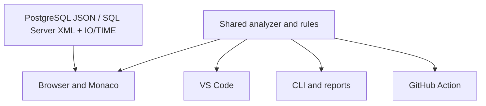

<p align="center"></p>

# SQL Atlas

**Local SQL diagnostics for editors, CI and the browser.** Inspect risky query patterns, follow findings to source locations and review PostgreSQL or SQL Server plans without sending SQL to an analysis service.

[English](README.md) · [Polski](README.pl.md) · [Live app](https://milekv.github.io/sql-atlas/) · [npm](https://www.npmjs.com/package/sql-atlas) · [VS Code Marketplace](https://marketplace.visualstudio.com/items?itemName=Milosz.sql-atlas) · [GitHub Action](https://github.com/marketplace/actions/sql-atlas)

[](https://github.com/milekv/sql-atlas/actions/workflows/ci.yml) [](https://www.npmjs.com/package/sql-atlas) [](LICENSE)

> **Release boundary:** npm, Marketplace, the extension and the live demo currently reflect published releases. The SQL Server plan improvements, Monaco diagnostics and other changes documented below are in this source branch until a new release is built and published. No 1.0 release is claimed.

## Try it

```bash
npx --yes sql-atlas@0.8.0 analyze examples/safe-query.sql --dialect postgresql
```

Or open the [browser demo](https://milekv.github.io/sql-atlas/) and paste a query. For the features in this source branch, run `npm ci && npm run dev` and open the local URL printed by Vite.

```sql
SELECT * FROM users WHERE LOWER(email) LIKE '%example.com';
```

The analyzer reports the matched ranges, explains why a pattern warrants review and offers possible next steps. `SELECT *`, a function on a filtered column and a leading wildcard may be relevant here. Whether an index or rewrite helps depends on the real schema, data and execution plan. SQL Atlas does **not** execute this query.

## In the browser

These screenshots were captured from the current source running locally in Chromium. They show features that have not yet been deployed to the public demo.

| Query diagnostics and source navigation | SQL Server Showplan XML |
| --- | --- |
|  |  |

[Index candidates](public/screenshots/index-advisor.png) · [PostgreSQL EXPLAIN](public/screenshots/postgresql-explain.png) · [Polish analyzer](public/screenshots/query-analyzer-pl.png)

## What is available

| Surface | Current behavior |
| --- | --- |
| Browser | Monaco findings and source navigation, index candidates, SQL knowledge base, PostgreSQL JSON EXPLAIN, SQL Server Showplan XML and STATISTICS IO/TIME import, PostgreSQL DDL visualization; English and Polish UI. |
| CLI | Local file/stdin analysis; text, JSON, Markdown and SARIF; language, dialect and policy options. |
| VS Code | Inline diagnostics, Problems panel, language setting, severity filtering and a file-level ignore quick fix. |
| GitHub Action | SQL file annotations, job summary and fail thresholds for pull request workflows. |

The Showplan importer displays operator trees, estimates, reported per-thread runtime counters, object names, memory grants and selected warnings. A second plan can be imported for structural comparison; differing `QueryHash` values are flagged. The tool does not infer an execution time from estimated cost or a root cause from an operator name alone. See [plan format and fixture notes](docs/PLAN_FORMATS.md).

| SQL input dialect | Static rules | Plan import |
| --- | --- | --- |
| PostgreSQL | Yes, heuristic | JSON EXPLAIN |
| SQL Server / T-SQL | Yes, heuristic | Showplan XML and separate IO/TIME messages |
| Oracle | Yes, heuristic | Not yet available |
| MySQL, SQLite, generic | Yes, heuristic | Not yet available |

Dialect selection does not imply full parsing of every vendor extension. The rule engine uses lexical masking and targeted patterns; complex procedural SQL and nested scopes still require manual review.

## Install and integrate

CLI:

```bash
npm install --save-dev sql-atlas@0.8.0
npx sql-atlas analyze 'migrations/**/*.sql' --dialect postgresql --format sarif --output sql-atlas.sarif
```

Policy configuration and suppressions are explained in [CLI and Action guide](docs/INTEGRATIONS.md). CLI exit codes are `0` for success, `1` for a configured policy failure and `2` for input/configuration errors.

GitHub Actions (published tag):

```yaml
name: SQL review
on: [pull_request]
permissions:
  contents: read
jobs:
  analyze:
    runs-on: ubuntu-latest
    steps:
      - uses: actions/checkout@v7
      - uses: milekv/sql-atlas@v0.8.0
        with:
          paths: '**/*.sql'
          dialect: postgresql
          fail-on: critical
```

Install [SQL Atlas for VS Code](https://marketplace.visualstudio.com/items?itemName=Milosz.sql-atlas) or build the source extension with `npm run package:vscode`. The browser, CLI, Action and extension share the same analyzer rules in this repository; releases may lag behind this branch.

## Professional workflows

- Review migration files in CI and inspect findings at exact source positions.
- Examine suspicious date predicates or broad reads, then compare alternative SQL on a representative database.
- Import a PostgreSQL `EXPLAIN (ANALYZE, BUFFERS, FORMAT JSON)` result or SQL Server `.sqlplan` into the local browser tool.
- Paste SQL Server `SET STATISTICS IO/TIME` messages as separate measurements; do not assume an imported plan and messages are from the same execution.

The [PostgreSQL date filter benchmark](benchmarks/postgresql/README.md) provides repeatable data, a result-equivalence check and measurement commands. No benchmark timings are reported without an actual database run.

## Privacy and scope

The analyzer and plan viewer work locally in the browser or on your own machine/CI runner. The project contains no required backend, account or AI service. The application does not upload pasted SQL or plans for analysis. Imported plans can contain object names, query text and literals; handle them as sensitive files. Opening the public demo still loads its static assets from GitHub Pages.

The static score measures matched rules, **not** latency, safety or correctness. Suggested indexes ignore existing schema, write overhead and data distribution. Example rewrites need semantic review. [Current implementation status](docs/IMPLEMENTATION_STATUS.md) lists tested behavior and open gaps.

## Architecture and development



Node.js 20+ and npm are required. Run `npm ci`, `npm test`, `npm run typecheck` and `npm run build`. The browser code lives in `src/features`, shared parsers and rules in `src/core`, integration adapters in `src/{cli,action,vscode}`, and tests in `src/tests`. See [architecture](ARCHITECTURE.md), [contributing](CONTRIBUTING.md), [roadmap](ROADMAP.md), [security](SECURITY.md) and [release process](docs/RELEASING.md).

## License

[MIT](LICENSE). The imported Microsoft sample plan has its own [MIT attribution](docs/THIRD_PARTY_NOTICES.md).
