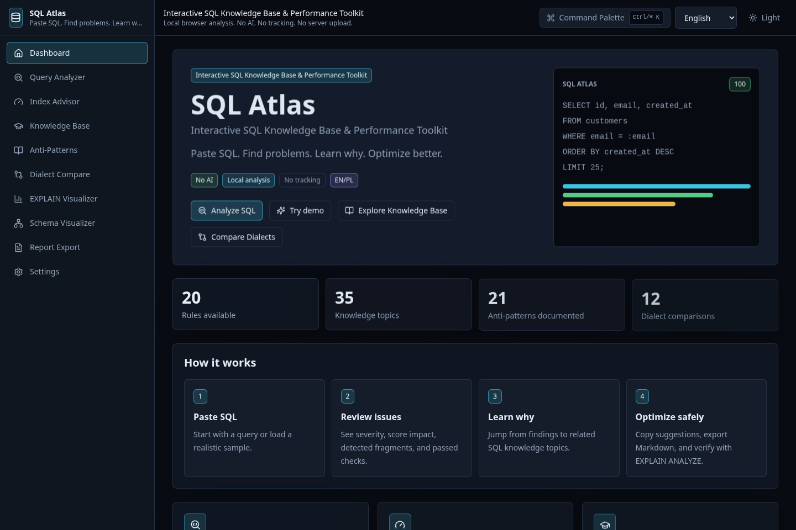

# SQL Atlas

Local SQL analysis for the terminal, pull requests, VS Code and the browser.
SQL Atlas applies deterministic rules to SQL, reports concrete findings and
keeps the analyzed source on the machine or GitHub runner where it was invoked.

[Live app](https://milekv.github.io/sql-atlas/) |
[GitHub Marketplace](https://github.com/marketplace/actions/sql-atlas) |
[npm](https://www.npmjs.com/package/sql-atlas) |
[VS Code](https://marketplace.visualstudio.com/items?itemName=Milosz.sql-atlas)
| [Polska wersja](README.pl.md)

[](https://github.com/milekv/sql-atlas/actions/workflows/ci.yml)
[](https://www.npmjs.com/package/sql-atlas)
[](LICENSE)

Current release: `v0.8.0`

## What it does

SQL Atlas is a static analysis and database tooling project. Its core analyzer
is shared by four interfaces:

- a CLI for local checks and CI pipelines
- a GitHub Action with annotations and job summaries
- a VS Code extension with diagnostics and rule suppression quick fixes
- a browser application for interactive analysis and supporting tools

The analyzer detects risky or expensive SQL patterns, assigns severity and
score information, identifies the relevant source range and suggests a next
step. It does not execute queries or claim to predict production performance.
Findings should be verified against the real schema, data distribution and
execution plan.

## Quick start

Analyze a file from the terminal:

```bash
npx --yes sql-atlas@0.8.0 analyze query.sql
```

Analyze several PostgreSQL files and return JSON:

```bash
npx --yes sql-atlas@0.8.0 analyze migrations/001.sql migrations/002.sql \
  --dialect postgresql \
  --format json
```

Use SQL Atlas in a pull request:

```yaml
name: SQL review

on:
  pull_request:
    paths:
      - "**/*.sql"

permissions:
  contents: read

jobs:
  sql-atlas:
    runs-on: ubuntu-latest
    steps:
      - uses: actions/checkout@v7
      - uses: milekv/sql-atlas@v0.8.0
        with:
          paths: "**/*.sql"
          dialect: postgresql
          fail-on: critical
```

## Analyzer

The rule-based analyzer currently covers patterns such as:

- `SELECT *` and unbounded reads
- `UPDATE` or `DELETE` without `WHERE`
- missing join conditions and cross joins
- functions in filters and leading-wildcard searches
- offset pagination and unbounded sorting
- `NOT IN` with nullable values
- implicit conversion risks
- excessive joins, `OR` conditions or grouping columns
- possible N+1 query patterns

Rules run independently for each parsed statement. PostgreSQL-aware scanning
handles quoted identifiers, escaped strings, nested block comments and
dollar-quoted function bodies so that SQL-looking text inside those regions is
not treated as executable structure.

The browser application adds:

- index suggestions derived from filters, joins, grouping and ordering
- a PostgreSQL `EXPLAIN (ANALYZE, BUFFERS, FORMAT JSON)` parser
- an execution tree with timing, buffer and estimation signals
- a PostgreSQL `CREATE TABLE` schema visualizer
- query structure mapping and before-and-after examples
- a SQL knowledge base and dialect comparison reference

Index suggestions and rewrites are starting points for verification, not
automatic migration advice.

## CLI reference

The CLI accepts one or more files or SQL from standard input. Analysis remains
local and the published package has no runtime dependencies.

```bash
echo "SELECT * FROM customers;" | npx --yes sql-atlas@0.8.0 analyze -
```

Apply a policy threshold in CI:

```bash
npx --yes sql-atlas@0.8.0 analyze schema.sql \
  --fail-on critical \
  --min-score 70
```

Export a report:

```bash
npx --yes sql-atlas@0.8.0 analyze query.sql \
  --format markdown \
  --output sql-report.md
```

Supported dialects:

- `postgresql`
- `mysql`
- `oracle`
- `sqlite`
- `sqlserver`
- `generic`

Supported output formats:

- human-readable text
- JSON
- Markdown
- SARIF 2.1.0

Generate SARIF for GitHub Code Scanning or another compatible viewer:

```bash
npx --yes sql-atlas@0.8.0 analyze "migrations/**/*.sql" \
  --format sarif \
  --output sql-atlas.sarif
```

Exit codes:

- `0` - analysis completed and configured thresholds passed
- `1` - a `--fail-on` or `--min-score` policy failed
- `2` - invalid arguments, configuration, unreadable input or empty SQL

Run `npx --yes sql-atlas@0.8.0 --help` for the complete command reference.

## Rule configuration and ignores

Disable rules for one command:

```bash
npx --yes sql-atlas@0.8.0 analyze query.sql \
  --ignore distinct-overuse,possible-n-plus-one-pattern
```

For a repository policy, create `sql-atlas.json`:

```json
{
  "rules": {
    "distinct-overuse": "off",
    "possible-n-plus-one-pattern": "off"
  }
}
```

Pass it to the CLI with `--config sql-atlas.json` or to the GitHub Action with
the `config` input. Unknown rule identifiers and invalid values are reported as
configuration errors rather than ignored silently.

A file can suppress specific rules without changing repository policy:

```sql
-- sql-atlas-ignore select-star, unbounded-select
SELECT * FROM small_reference_table;
```

Disabled rules are excluded from findings, scores and passed checks.

## GitHub Action

The Action resolves repository-relative glob patterns, analyzes matching SQL
files and provides:

- file annotations for findings
- a Markdown report in the job summary
- `files`, `findings` and `lowest-score` outputs
- `fail-on` and `min-score` policy controls
- shared configuration and workflow-level ignores

Example with a shared policy:

```yaml
- uses: milekv/sql-atlas@v0.8.0
  with:
    paths: |
      migrations/**/*.sql
      schema/**/*.sql
    dialect: postgresql
    config: sql-atlas.json
    ignore: distinct-overuse
    fail-on: critical
    min-score: 60
```

Empty files are skipped with a warning. A run fails only when the configured
policy is violated or when the input or configuration is invalid.

## VS Code extension

The extension analyzes `.sql` documents as they are edited and exposes
findings through native VS Code diagnostics. It supports:

- all SQL Atlas dialects
- a configurable minimum severity
- workspace-level ignored rules
- a quick fix for adding a file-level `sql-atlas-ignore` directive

Analysis is performed inside the extension process. It does not require a
database connection or external analysis service.

Build a VSIX locally:

```bash
npm run package:vscode
```

## Browser application

The [browser app](https://milekv.github.io/sql-atlas/) runs without an account
or backend. SQL is analyzed in the browser and is not uploaded to a service.
The interface is available in English and Polish.

Screenshots:

| Query analyzer | EXPLAIN and supporting tools |
| --- | --- |
|  |  |

The repository does not include application analytics or a database
connection. As with any developer tool, remove secrets and private customer
data before using real production examples.

## Architecture

The deterministic core is separated from each delivery surface:

```text
src/core/analyzer       rules, scoring and configuration
src/core/index-advisor  structural index suggestions
src/core/explain        PostgreSQL EXPLAIN JSON parser
src/core/schema         PostgreSQL CREATE TABLE parser
src/cli                 terminal interface and reports
src/action              GitHub Action integration
src/vscode              editor diagnostics
src/features            browser application features
src/tests               unit and integration tests
```

This boundary keeps the CLI, Action, editor extension and browser app aligned
without duplicating analyzer behaviour.

## Local development

Requirements:

- Node.js 20 or newer
- npm

```bash
git clone https://github.com/milekv/sql-atlas.git
cd sql-atlas
npm ci
npm run dev
```

Run the project checks:

```bash
npm run typecheck
npm test
npm run build
```

CI verifies the TypeScript build, test suite and committed GitHub Action
bundle. Separate workflows smoke-test the Action and deploy the browser app to
GitHub Pages.

## Current limitations

- Analysis is static and does not use database statistics or execute SQL.
- Dialect support is rule-aware but not a complete parser for every vendor
  extension.
- Index suggestions cannot account for write cost, existing indexes, table
  size or production data distribution.
- The schema visualizer currently targets PostgreSQL `CREATE TABLE` input.
- The VS Code extension and CLI share analyzer rules but do not expose every
  browser-only visualization.

These constraints are intentional boundaries of the current release. When
performance matters, validate recommendations with representative data,
`EXPLAIN ANALYZE`, monitoring and database-specific review.

## Contributing

See [CONTRIBUTING.md](CONTRIBUTING.md) for setup, test expectations and guidance
for analyzer changes. Bug reports should include a minimal SQL example and the
selected dialect.

## License

[MIT](LICENSE)
