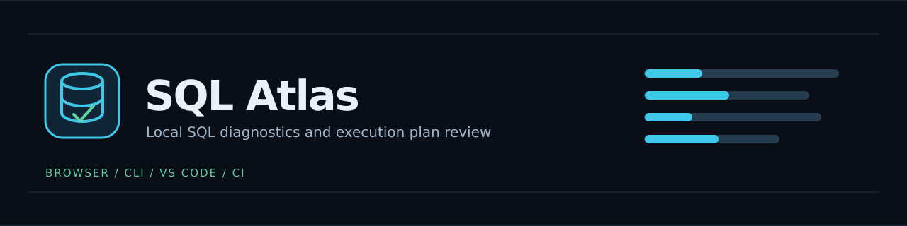
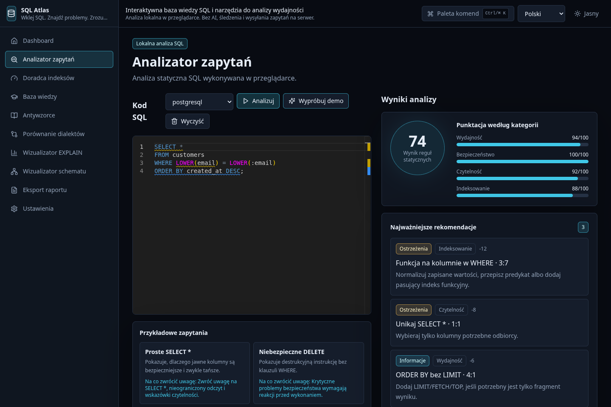
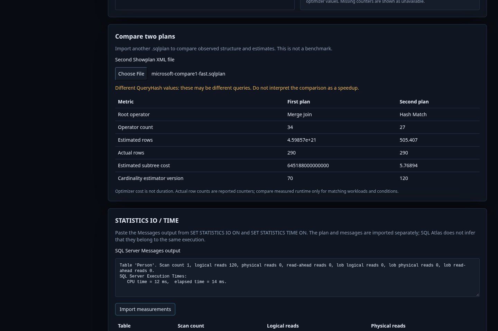
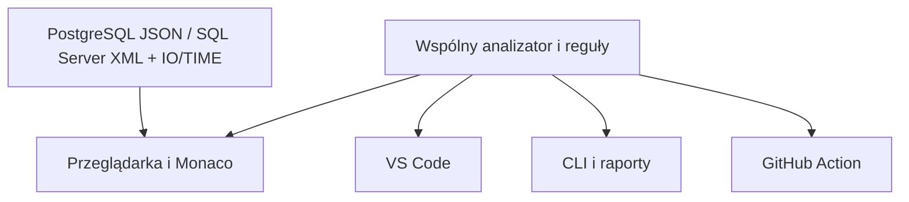

<p align="center"></p>

# SQL Atlas

**Lokalna diagnostyka SQL w edytorze, CI i przeglądarce.** Sprawdzaj ryzykowne wzorce zapytań, przechodź do miejsca problemu w kodzie oraz przeglądaj plany PostgreSQL i SQL Server bez wysyłania SQL do usługi analizującej.

[English](README.md) · [Polski](README.pl.md) · [Demo](https://milekv.github.io/sql-atlas/) · [npm](https://www.npmjs.com/package/sql-atlas) · [VS Code Marketplace](https://marketplace.visualstudio.com/items?itemName=Milosz.sql-atlas) · [GitHub Action](https://github.com/marketplace/actions/sql-atlas)

[](https://github.com/milekv/sql-atlas/actions/workflows/ci.yml) [](https://www.npmjs.com/package/sql-atlas) [](LICENSE)

> **Stan wydania:** npm, Marketplace, rozszerzenie i publiczne demo odpowiadają opublikowanym wersjom. Rozbudowany import planów SQL Server, diagnostyka Monaco i pozostałe zmiany opisane poniżej są dostępne w kodzie tej gałęzi do czasu nowego wydania. Projekt nie jest oznaczony jako 1.0.

## Wypróbuj

```bash
npx --yes sql-atlas@0.8.0 analyze examples/safe-query.sql --dialect postgresql
```

Możesz też otworzyć [demo w przeglądarce](https://milekv.github.io/sql-atlas/) i wkleić zapytanie. Aby uruchomić funkcje z bieżącego kodu, wykonaj `npm ci && npm run dev` i otwórz lokalny adres pokazany przez Vite.

```sql
SELECT * FROM users WHERE LOWER(email) LIKE '%example.com';
```

Analizator pokazuje miejsce trafienia reguły, wyjaśnia, co warto sprawdzić, i proponuje dalsze kroki. W tym przykładzie znaczenie mogą mieć `SELECT *`, funkcja na filtrowanej kolumnie oraz wildcard na początku wzorca. To, czy indeks lub zmiana zapytania pomoże, zależy od schematu, danych i planu wykonania. SQL Atlas **nie wykonuje** tego zapytania.

## W przeglądarce

Zrzuty wykonano w Chromium z bieżącej wersji kodu uruchomionej lokalnie. Pokazują również funkcje, których nie wdrożono jeszcze do publicznego demo.

| Diagnostyka zapytań i przejście do kodu | Plan SQL Server Showplan XML |
| --- | --- |
|  |  |

[Kandydaci na indeksy](public/screenshots/index-advisor.png) · [PostgreSQL EXPLAIN](public/screenshots/postgresql-explain.png) · [Angielski analizator](public/screenshots/query-analyzer.png)

## Dostępne narzędzia

| Miejsce użycia | Działanie w bieżącym kodzie |
| --- | --- |
| Przeglądarka | Diagnostyka Monaco z nawigacją do kodu, kandydaci na indeksy, baza wiedzy, PostgreSQL EXPLAIN JSON, SQL Server Showplan XML i import STATISTICS IO/TIME, wizualizacja DDL PostgreSQL; interfejs polski i angielski. |
| CLI | Lokalna analiza pliku lub stdin; raporty tekstowe, JSON, Markdown i SARIF; ustawienia języka, dialektu i progów. |
| VS Code | Diagnostyka w edytorze i panelu Problemy, wybór języka, filtrowanie ważności, szybka poprawka wyciszająca regułę w pliku. |
| GitHub Action | Adnotacje przy plikach SQL, podsumowanie zadania i progi powodujące niepowodzenie kontroli PR. |

Import Showplan pokazuje drzewo operatorów, estymacje, zgłoszone liczniki dla poszczególnych wątków, nazwy obiektów, pamięć i wybrane ostrzeżenia. Można wczytać drugi plan do porównania struktury; różne wartości `QueryHash` są sygnalizowane. Narzędzie nie wyprowadza czasu wykonania z kosztu optymalizatora ani przyczyny spowolnienia z samej nazwy operatora. Szczegóły: [formaty planów i próbki](docs/PLAN_FORMATS.md).

| Dialekt wejściowego SQL | Reguły statyczne | Import planu |
| --- | --- | --- |
| PostgreSQL | Tak, heurystyczne | EXPLAIN JSON |
| SQL Server / T-SQL | Tak, heurystyczne | Showplan XML i osobno komunikaty IO/TIME |
| Oracle | Tak, heurystyczne | Jeszcze niedostępny |
| MySQL, SQLite, ogólny | Tak, heurystyczne | Jeszcze niedostępny |

Wybór dialektu nie oznacza pełnego parsera wszystkich rozszerzeń danego silnika. Silnik reguł używa maskowania leksykalnego i wybranych wzorców; złożone bloki proceduralne i zagnieżdżenia wymagają przeglądu człowieka.

## Instalacja i integracja

CLI:

```bash
npm install --save-dev sql-atlas@0.8.0
npx sql-atlas analyze 'migrations/**/*.sql' --dialect postgresql --format sarif --output sql-atlas.sarif
```

Konfigurację progów i wyciszeń opisuje [przewodnik CLI i Action](docs/INTEGRATIONS.md). Kody zakończenia CLI: `0` oznacza powodzenie, `1` przekroczenie skonfigurowanego progu, `2` błąd wejścia lub konfiguracji.

GitHub Actions (opublikowany tag):

```yaml
name: SQL review
on: [pull_request]
permissions:
  contents: read
jobs:
  analyze:
    runs-on: ubuntu-latest
    steps:
      - uses: actions/checkout@v7
      - uses: milekv/sql-atlas@v0.8.0
        with:
          paths: '**/*.sql'
          dialect: postgresql
          fail-on: critical
```

Zainstaluj [SQL Atlas dla VS Code](https://marketplace.visualstudio.com/items?itemName=Milosz.sql-atlas) albo zbuduj rozszerzenie z kodu poleceniem `npm run package:vscode`. Przeglądarka, CLI, Action i rozszerzenie współdzielą reguły analizatora w repozytorium; publikowane wersje mogą być starsze.

## Zastosowanie w pracy

- Kontroluj migracje w CI i przechodź do dokładnej pozycji znalezionego problemu.
- Sprawdź podejrzany filtr dat lub szeroki odczyt, a potem porównaj alternatywne zapytania na reprezentatywnej bazie.
- Importuj wynik PostgreSQL `EXPLAIN (ANALYZE, BUFFERS, FORMAT JSON)` lub plik SQL Server `.sqlplan` do lokalnej aplikacji.
- Wklej komunikaty SQL Server `SET STATISTICS IO/TIME` jako osobne pomiary. Nie zakładaj, że pochodzą z tego samego wykonania co zaimportowany plan.

[Benchmark filtra dat PostgreSQL](benchmarks/postgresql/README.md) zawiera odtwarzalne dane, sprawdzenie zgodności wyników i polecenia pomiarowe. Nie publikujemy czasu wykonania bez uruchomienia bazy.

## Prywatność i ograniczenia

Analizator i wizualizator działają lokalnie w przeglądarce lub na Twoim komputerze albo runnerze CI. Projekt nie wymaga backendu, konta ani AI. Aplikacja nie wysyła wklejonego SQL lub planów do usługi analizującej. Plany mogą zawierać nazwy obiektów, treść zapytań i literały; traktuj je jako dane poufne. Publiczne demo pobiera zasoby statyczne z GitHub Pages.

Ocena statyczna mierzy trafienia reguł, **nie** czas wykonania, bezpieczeństwo ani poprawność. Sugestie indeksów nie znają istniejącego schematu, kosztu zapisu ani rozkładu danych. Przykłady zmian SQL wymagają sprawdzenia semantyki. [Stan implementacji](docs/IMPLEMENTATION_STATUS.md) podaje wyniki testów i otwarte problemy.

## Architektura i rozwój



Wymagane są Node.js 20+ i npm. Uruchom `npm ci`, `npm test`, `npm run typecheck` i `npm run build`. Aplikacja przeglądarkowa jest w `src/features`, wspólne parsery i reguły w `src/core`, adaptery w `src/{cli,action,vscode}`, a testy w `src/tests`. Zobacz [architekturę](ARCHITECTURE.md), [zasady współtworzenia](CONTRIBUTING.md), [plan rozwoju](ROADMAP.md), [bezpieczeństwo](SECURITY.md) i [proces wydania](docs/RELEASING.md).

## Licencja

[MIT](LICENSE). Przykładowy plan Microsoftu ma osobną [informację o licencji MIT](docs/THIRD_PARTY_NOTICES.md).
